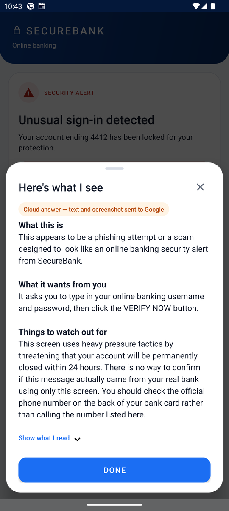
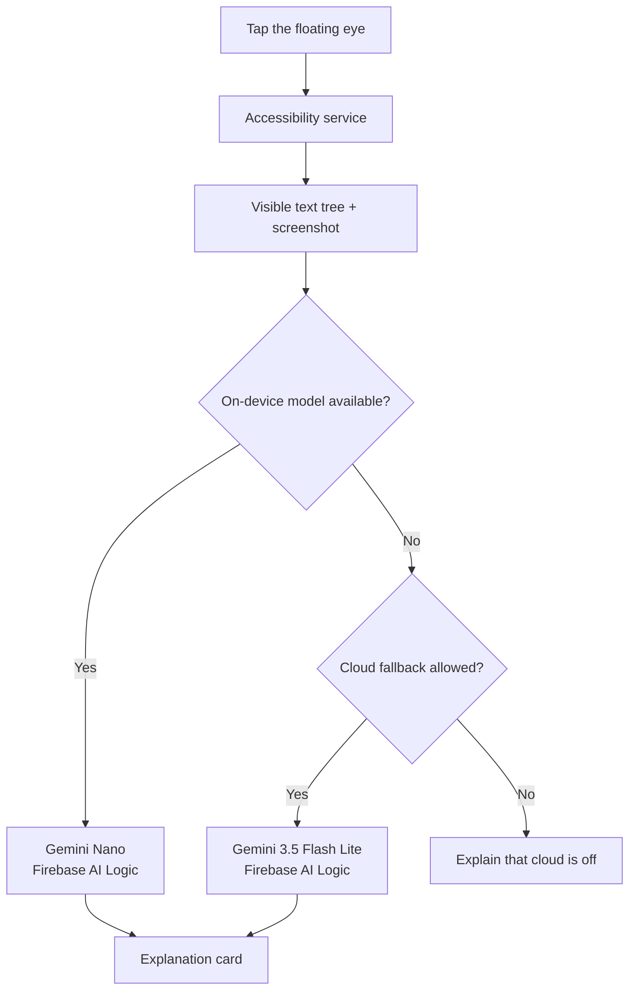
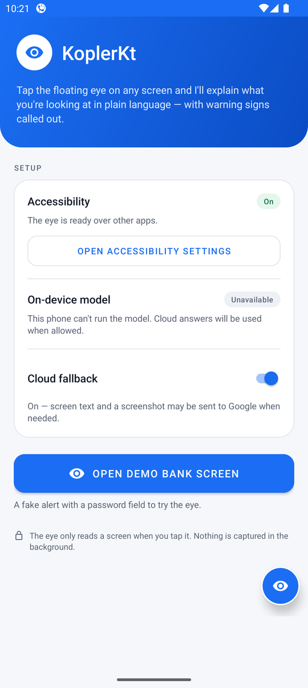
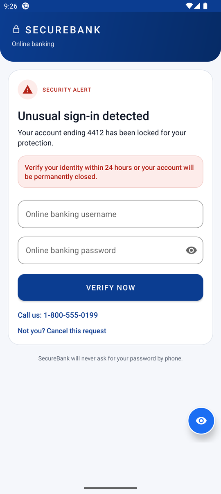
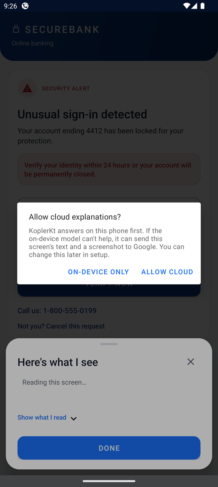
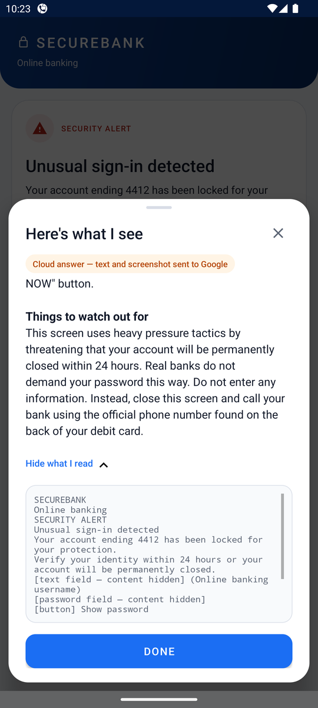

# KoplerKt

### Understand any screen. On-device first. Cloud only when you allow it.

[](LICENSE)


[](https://github.com/VesperQuartz/KoplerKt/releases/latest)

KoplerKt is an Android app for the moments when a screen makes no sense.

Tap the floating eye and it explains what you are looking at in plain language, calls out warning signs, and tells you whether the answer came from this phone or from the cloud.

<p align="center">
  
</p>

## Install the demo

1. Download the latest APK from [Releases](https://github.com/VesperQuartz/KoplerKt/releases/latest).
2. Allow installation from this source if Android asks.
3. Open KoplerKt and enable the accessibility service.
4. Open the demo bank screen and tap the floating eye.

The demo APK is signed and ready to install. It is not a Play Store build.

## What it does

- **Explains any screen** in three short sections: what it is, what it wants from you, and what to watch out for.
- **Warns about scams** without ever calling a screen "safe" or "legitimate".
- **Runs on-device first** using Gemini Nano through Firebase AI Logic. The green badge means the answer never left the phone.
- **Falls back to the cloud** only when the on-device model is unavailable or cannot answer, and only after you allow it.
- **Masks passwords and editable fields** before any text leaves the app.
- **Shows its work** with a "Show what I read" view of the captured screen text.
- **Captures only on tap.** The accessibility service does not read anything in the background.

## Why hybrid inference

Phone screens are full of small decisions: permission prompts, bank alerts, delivery notices, settings pages, error dialogs. For many people — older adults, non-native speakers, people with cognitive disabilities, or anyone in a hurry — the cost of guessing is high.

Cloud-only assistants can explain those screens, but they require sending the screen away. KoplerKt flips the default:

1. Use the local model when the device can run it. It is fast, private, and works offline.
2. Use the cloud only when the local model cannot help, and only with explicit consent.
3. Always show which path produced the answer.

That is the hybrid inference story in one interaction.

## How it works



1. The accessibility service draws a floating eye over the current app. It receives events but ignores them; capture starts on tap.
2. On tap, it reads the active window's text tree and takes a screenshot on Android 11+. Password and editable fields are replaced with a masked label.
3. The eye is removed before the screenshot, so it never appears in the image.
4. `ExplanationActivity` tries the on-device model first.
5. If the on-device answer is unavailable or blank, and cloud fallback is allowed, it sends the text and screenshot to the cloud model.
6. The card shows a green **Answered on this phone** badge or an amber **Cloud answer — text and screenshot sent to Google** badge.
7. Closing the card returns the floating eye and leaves the underlying app exactly where it was.

## Firebase AI Logic at runtime

Firebase AI Logic is the only inference path. It is imported and called at runtime in [`ExplanationActivity.kt`](app/src/main/java/ng/mrlectus/koplerkt/ExplanationActivity.kt).

**On-device:**

```kotlin
private val onDeviceModel by lazy {
    firebaseAI.generativeModel(
        modelName = MODEL_NAME,
        onDeviceConfig = OnDeviceConfig(
            mode = InferenceMode.ONLY_ON_DEVICE,
            maxOutputTokens = 256,
        ),
    )
}

val answer = onDeviceModel.generateContent(prompt).text
```

**Cloud fallback:**

```kotlin
private val cloudModel by lazy {
    firebaseAI.generativeModel(modelName = MODEL_NAME)
}

val parts = mutableListOf<Part>(TextPart(prompt))
if (screenshot != null) parts += ImagePart(screenshot)
val response = cloudModel.generateContent(Content(role = null, parts = parts))
```

The routing logic lives in `requestExplanation()`: it checks `OnDeviceModelStatus.AVAILABLE`, tries the local model with a timeout, then checks the saved cloud consent before using the cloud model.

App Check is initialized at startup in [`KoplerKtApplication.kt`](app/src/main/java/ng/mrlectus/koplerkt/KoplerKtApplication.kt):

```kotlin
Firebase.initialize(context = this)
Firebase.appCheck.installAppCheckProviderFactory(
    DebugAppCheckProviderFactory.getInstance(),
)
```

The debug provider is intentional for the hackathon demo. Firebase AI Logic debug tokens are accepted in #BuildHybridAI submissions. For production, replace it with a release App Check provider.

## Privacy and safety

- **Tap-only capture.** `onAccessibilityEvent` is a no-op. The service only reads a screen when the eye is tapped.
- **Passwords stay hidden.** `isPassword` and `isEditable` nodes are replaced with `[password field — content hidden]` or `[text field — content hidden]`.
- **Screenshots are explicit.** The app captures a screenshot only on tap, hides the eye first, and sends it only to the cloud path after consent.
- **Cloud is opt-in.** The first explanation asks for permission. The choice is saved and can be changed in setup.
- **No app analytics, accounts, or server-side storage of captures.** The app does not store captured screens or answers.
- **On-device answers stay on the device.** The cloud model is only used when the local model cannot answer and cloud fallback is allowed.
- **Never says "safe".** The prompt forbids calling a screen safe, secure, legitimate, or free of risk.

KoplerKt describes what it sees. It is not a guarantee. When money or credentials are involved, verify with the official app, website, or phone number.

See [PRIVACY.md](PRIVACY.md) for the full policy.

## Demo

| Setup | Demo bank screen | Explanation |
|:---:|:---:|:---:|
|  |  |  |

| Cloud consent | Show what I read |
|:---:|:---:|
|  |  |

A 3-minute demo video will be linked here before the #BuildHybridAI submission deadline.

The built-in **Open demo bank screen** is a fake alert created for testing. It contains no real bank data.

## Getting started

### Requirements

- Android Studio with Android SDK 37
- JDK 17 or newer (the build uses a Java 25 toolchain managed by Gradle)
- Android 8.0 (API 26) or newer
- A Gemini Nano-capable device for on-device answers, or any network-connected device for cloud fallback

### Build and install

```bash
git clone https://github.com/VesperQuartz/KoplerKt.git
cd KoplerKt
./gradlew :app:assembleDebug
adb install -r app/build/outputs/apk/debug/app-debug.apk
```

### Enable the floating eye

Open KoplerKt, tap **Open accessibility settings**, then turn on **KoplerKt**.

> **Android 13+ sideload note:** if the KoplerKt toggle is grayed out, open **Settings → Apps → KoplerKt → ⋮ → Allow restricted settings**, then try again. Android applies this to apps installed outside an app store.

Or from a terminal:

```bash
adb shell settings put secure enabled_accessibility_services \
  ng.mrlectus.koplerkt/ng.mrlectus.koplerkt.ScreenWhispererService
adb shell settings put secure accessibility_enabled 1
```

### Firebase configuration

The repository includes [`app/google-services.json`](app/google-services.json) for the demo Firebase project. It is a client configuration, not a server secret. Replace it with your own Firebase Android app for production.

If you use your own project:

1. Create an Android app with package name `ng.mrlectus.koplerkt`.
2. Enable Firebase AI Logic and App Check.
3. Download the new `google-services.json` into `app/`.
4. Run the app, find the App Check debug token in Logcat, and add it in **Firebase Console → App Check → Apps → Manage debug tokens** if you enable enforcement.

### On-device model

The **On-device model** row in setup shows one of:

- **Ready** — on-device answers are available.
- **Download** — the model needs to download. Keep the setup screen open while it finishes.
- **Unavailable** — this device cannot run the local model; cloud fallback is used when allowed.

On an emulator, the on-device model is normally unavailable. That is expected; the cloud path is still fully testable.

### Try it

1. Open **Open demo bank screen**.
2. Tap the floating eye.
3. Allow cloud fallback on the first run if you want to see the cloud path.
4. Compare the green on-device badge with the amber cloud badge.
5. Tap **Show what I read** to verify that the password field is masked.

### Release APK

[Download the signed demo APK](https://github.com/VesperQuartz/KoplerKt/releases/latest).

SHA-256 of the v0.1.0 APK:

```text
b15db9273858268ee6df79abd4b77ca58dd8e8067e591e07893d70e6a3266f30
```

The debug APK is also usable for local development.

## Supported devices and limitations

- On-device inference requires Gemini Nano-capable hardware with AICore. The app checks availability at runtime and falls back to the cloud when allowed.
- Screenshots require Android 11 (API 30) or newer. On older versions the app sends text only.
- Screens with `FLAG_SECURE` cannot be captured; the app falls back to the text tree.
- The accessibility service must be enabled manually. Android does not allow an app to enable it for you.
- The app is distributed as an APK, not through the Play Store.
- The UI and prompt are English-only for this submission.

For the step-by-step phone validation plan, see [docs/on-device-test.md](docs/on-device-test.md).

## Project structure

```text
app/src/main/java/ng/mrlectus/koplerkt/
├── ScreenWhispererService.kt   floating eye, drag, screenshot capture
├── ScreenTextReader.kt         accessibility tree walk + masking
├── ExplanationActivity.kt      on-device/cloud routing, prompt, UI
├── MainActivity.kt             setup, model status, cloud consent
├── CloudPreferences.kt         saved cloud fallback choice
├── NetworkState.kt             offline detection
├── MaxHeightScrollView.kt      bounded explanation scroll area
├── DemoScamActivity.kt         fake bank screen for testing
└── KoplerKtApplication.kt      Firebase + App Check initialization
```

## Built during #BuildHybridAI 2026

KoplerKt started as a Kotlin Android template. During the #BuildHybridAI 2026 submission period (November 9–30, 2026), it was significantly updated into the app described here:

- the accessibility service and draggable floating eye
- the text-tree reader with password and editable-field masking
- on-device first routing through Firebase AI Logic, with cloud fallback
- explicit cloud consent, saved preferences, and source badges
- screenshot capture with the eye hidden
- the setup screen, model download state, and scam demo
- the explanation bottom sheet and the full visual redesign

## Roadmap

- Risk highlighting over the exact elements the model flags, using accessibility node bounds.
- Multimodal on-device answers when Gemini Nano exposes image input.
- Localization and a larger set of demo screens.
- Play Store release with a production App Check provider.

## License

MIT License. See [LICENSE](LICENSE).

Built with Kotlin, Android Accessibility APIs, Firebase AI Logic, Gemini Nano, Gemini 3.5 Flash Lite, and Material Components.
